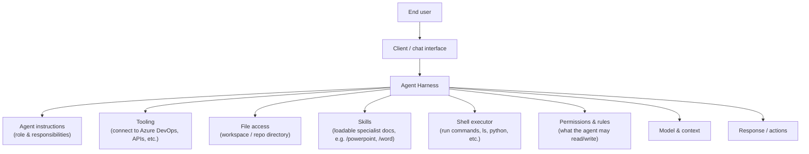
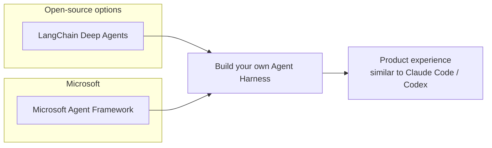
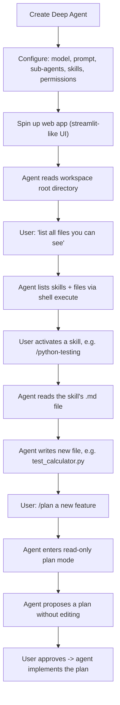
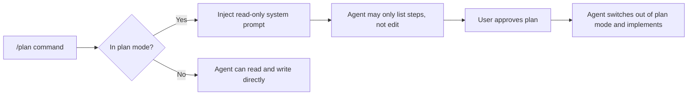
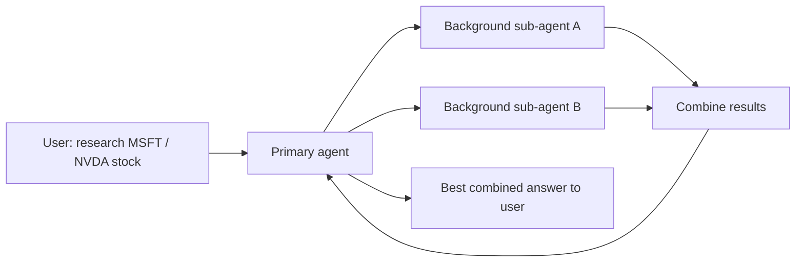

# What Is an Agent Harness?

**Visual goal:** Understand the building blocks behind coding-agent products (Claude Code, Codex, GitHub Copilot Coding Agent) and how to assemble your own using an open framework such as Microsoft Agent Framework or LangChain Deep Agents.

## Big picture: the agent harness

Every "coding agent" product an end user interacts with is really a **harness** wrapped around a model: a bundle of instructions, tools, files, skills, a shell, and permission rules working together.

Products like Claude Code or Codex are simply well-tuned instances of this same structure running behind the scenes.

## Core components explained

| Component | Purpose |
|---|---|
| Agent instructions | Defines the agent's role (e.g. coding agent, finance agent) |
| Tooling | Lets the agent call external services (Azure DevOps tasks, card creation, APIs) |
| File access | Root workspace directory the agent can read/write files from |
| Skills | Loadable specialist playbooks (e.g. `/powerpoint`, `/word`, `/work-tree`) pulled from a repo of skills |
| Shell executor | Runs commands (`ls`, `python`, etc.) so the agent can inspect and act on the environment |
| Permissions & rules | Governs what the agent is allowed to access or modify |
| Model & context | The underlying LLM and the context window it reasons over |

> **Mental model:** Think of the harness as the "operating system" around the model — instructions are its job description, tools are its hands, skills are its manuals, and the shell is how it actually gets work done.

## Frameworks that help build a harness

Both frameworks expose the same underlying pieces: model selection, prompt/instructions, sub-agents, skills, permissions, and backend tool access.

## Demo flow: building a simple coding agent

## Plan mode: what happens behind the scenes

Plan mode is implemented as a simple rule/prompt-injection check, not a separate model — if the harness detects "plan mode," it swaps in a read-only system prompt that restricts the agent to listing steps.

## Sub-agents in action

## Visual learning path

1. Start from the end-user experience of products like Claude Code or Codex.
2. Break the harness into its parts: instructions, tools, file access, skills, shell, permissions, context.
3. Pick a framework (LangChain Deep Agents or Microsoft Agent Framework) to scaffold these parts quickly.
4. Wire up a workspace directory and a set of skills the agent can load on demand.
5. Add plan mode as a read-only guard rail before allowing edits.
6. Extend with sub-agents for parallel background research/work.

## Check your understanding

1. What are the core building blocks of an agent harness?
2. How do skills differ from tools in this architecture?
3. How does plan mode restrict the agent, and how is it implemented under the hood?
4. Why might a harness use sub-agents instead of a single agent?
5. Name two frameworks that can help scaffold an agent harness.
